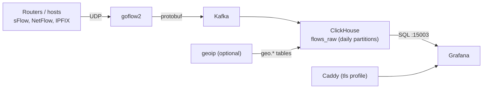

# NetMeta

> [!NOTE]
> **This is a heavily modified fork of [NetMeta](https://github.com/monogon/NetMeta/) by
> [Monogon SE](https://monogon.tech).** All credit for the original design, ClickHouse schema and dashboards goes
> to the upstream authors.
>
> This fork replaces upstream's Kubernetes (k3s), Bazel and CUE deployment with a single-host Docker Compose stack.
> It moves to goflow2 v2, ClickHouse 25.8 and Kafka in KRaft mode. It adds optional MaxMind/IPinfo ASN and country
> enrichment in place of the hard dependency on an external RIB service. It removes the port-mirror collector and the
> FastNetMon integration. It isn't affiliated with or supported by Monogon. Please report problems with this fork
> here, not upstream.

NetMeta is a network flow analytics stack: routers and hosts export sFlow, NetFlow or IPFIX, and NetMeta stores
every flow in ClickHouse and charts it in Grafana.

Flows are not pre-aggregated and are stored with one-second resolution, so you can query in any dimension with
high-fidelity graphs.

## Features

* sFlow v5, NetFlow v5/v9 and IPFIX, collected by [goflow2](https://github.com/netsampler/goflow2) v2.
  See [doc/ingest.md](doc/ingest.md) for the trade-offs between them and for host and port-mirror collection.
* The sampling rate is detected automatically. Devices with different sampling rates can be mixed.
* IPv6 is supported throughout the stack.
* Optional ASN and country enrichment from MaxMind, IPinfo, local `.mmdb` files or RouteViews.
  It is off by default, and NetMeta makes no external calls unless you enable it. See [doc/enrichment.md](doc/enrichment.md).
* A bundled Grafana with provisioned dashboards, or use your own. See [doc/grafana.md](doc/grafana.md).

## Demo


## Quickstart

NetMeta runs on one host with Docker Engine and the Compose plugin (`docker compose`).

```bash
git clone https://github.com/slothnetworks/sflow netmeta && cd netmeta
cp .env.example .env
$EDITOR .env    # set CLICKHOUSE_PASSWORD, CLICKHOUSE_GRAFANA_PASSWORD, GRAFANA_ADMIN_PASSWORD, GRAFANA_SECRET_KEY
docker compose up -d
```

Then point your exporters at the host and open Grafana on `http://<host>:15001`.

To put Grafana behind TLS on `https://<PUBLIC_HOSTNAME>:15002`, enable the optional Caddy profile. `TLS_MODE` in
`.env` chooses `internal` (a self-signed certificate from Caddy's local CA) or `acme` (Let's Encrypt, which needs
Caddy on public port 80 or 443):

```bash
docker compose --profile tls up -d
```

Set `COMPOSE_PROFILES=tls` in `.env` as well, so that later `docker compose` commands include Caddy. Set
`GRAFANA_ROOT_URL=https://<PUBLIC_HOSTNAME>:15002/` too, and once nobody signs in over plain HTTP any more,
`GRAFANA_COOKIE_SECURE=true`.

Edit the files in `config/data/` (sampler, interface, VLAN and host names, your own ASNs) to label the
dashboards; ClickHouse reloads them within 60 seconds. See [config/data/README.md](config/data/README.md).

Day-2 tasks (SQL console, Kafka lag, retention, partitions) are in [doc/operations.md](doc/operations.md).
To move an existing k3s deployment, see [doc/migrate-from-k3s.md](doc/migrate-from-k3s.md).

### Ports

| Port              | Service                      | Notes                                                       |
|-------------------|------------------------------|-------------------------------------------------------------|
| 2055/udp          | goflow2: NetFlow v5/v9, IPFIX | Restrict to exporter addresses                              |
| 2056/udp          | goflow2: NetFlow v5/v9, IPFIX | Kept for exporters configured for the old NetFlow v5 port    |
| 6343/udp          | goflow2: sFlow               | Restrict to exporter addresses                              |
| 15001/tcp         | Grafana (plain HTTP)         |                                                             |
| 15002/tcp         | Caddy (TLS profile only)     |                                                             |
| 15003/tcp         | ClickHouse HTTP              | **Plain HTTP**, user `admin`. Firewall it if not needed off-host |
| 127.0.0.1:18080   | goflow2 metrics              | Loopback only                                               |

All ports can be changed in `.env`. goflow2 runs with host networking so that it sees the real exporter
source addresses.

### Sizing

Ingestion is limited by CPU and disk bandwidth; queries by disk and memory bandwidth and the memory available for
large aggregations. Most reads and writes are sequential, so network storage or spinning disks work, but local NVMe
is best. Flow retention is `RETENTION_DAYS` in `.env` (default 7).

## Architecture



The `migrate` service runs once at start-up. It applies the SQL migrations in `sql/migrations`, re-creates the
functions in `sql/functions` and `config/clickhouse/isIncomingFlow.sql`, and sets the `flows_raw` TTL from
`RETENTION_DAYS`.

## API stability

NetMeta is beta software. Its interfaces are:

* the `.env` settings and the files in `config/`;
* the ClickHouse SQL schema (`flows_raw`, functions and dictionaries) for raw database access;
* the protobuf schema on the Kafka topic, for custom processors.

## Development

```bash
make vet test lint vuln   # Go checks
make images               # build the geoip and migrate images
make e2e                  # bring up the stack, send test flows, run every dashboard query
```

## Related

NetMeta is built on [ClickHouse](https://clickhouse.com), [Kafka](https://kafka.apache.org),
[Grafana](https://grafana.com/) with the
[ClickHouse datasource](https://github.com/grafana/clickhouse-datasource), and
[goflow2](https://github.com/netsampler/goflow2).

---

Original work (C) 2022 [Monogon SE](https://monogon.tech), [github.com/monogon/NetMeta](https://github.com/monogon/NetMeta/).
Modifications in this fork (C) 2026 Slothnetworks. Both are licensed under the [Apache License 2.0](LICENSE).

This software is provided "as-is" and
without any express or implied warranties, including, without limitation, the implied warranties of
merchantability and fitness for a particular purpose.
